<div align="center">



# Contributing to WISHLY

**Thank you for helping a small kindness travel further.**

<a href="#ground-rules">Ground rules</a> &nbsp;·&nbsp;
<a href="#set-up">Set up</a> &nbsp;·&nbsp;
<a href="#where-things-live">Where things live</a> &nbsp;·&nbsp;
<a href="#recipes">Recipes</a> &nbsp;·&nbsp;
<a href="#working-on-animations">Animations</a> &nbsp;·&nbsp;
<a href="#money-and-privacy-rules">Money rules</a> &nbsp;·&nbsp;
<a href="#pull-requests">Pull requests</a>

</div>


## Ground rules

- **Be kind.** WISHLY is about people helping people. Treat issues, reviews and discussions the same way.
- **Keep it small and readable.** The backend is a dependency-free Node handler and the front end is plain ES modules with no build step. A change that adds a framework, a bundler or a heavy dependency needs a strong reason, discussed in an issue first.
- **Money and privacy come first.** Read [Money and privacy rules](#money-and-privacy-rules) before you touch payments, fees, bill details or user data.
- **Originality.** Only submit code you wrote or have the right to contribute. If you adapt something (for example an effect from a component library), say where it came from and make sure its license allows it.
- **One idea per pull request.** Small, focused changes are reviewed quickly.

> [!IMPORTANT]
> **Found a security problem?** Please do not open a public issue. Contact the maintainer privately, describe how to reproduce it, and give them time to fix it before sharing details. Never include real keys, real bill references or real user data in an issue.


## Set up

Requires Node.js **22.13+**.

```bash
cd WISHLY
npm install
cp .env.example .env          # Windows PowerShell: Copy-Item .env.example .env
npm run seed                  # optional demo accounts (password wishly-demo-2026)
npm run dev                   # http://localhost:4000
```

Sign-up and browsing work with no PayMongo keys; verification links print to the server console. Add **test** keys (`sk_test_...`) only when working on checkout, and never commit `.env`.

| Command | What it does |
|---|---|
| `npm run dev` / `npm start` | Start the server (with / without auto-restart). |
| `npm test` | Run the automated test suites (in-memory SQLite, fake PayMongo). |
| `npm run build` | Syntax-check server and client, scan `/public` for secrets, validate migrations. |
| `npm run migrate` | Apply pending migrations (SQLite, or PostgreSQL when `DATABASE_URL` is set). |
| `npm run smoke` | With the server running, exercise signup, cookie session, login failure and logout. |
| `npm run make-admin -- you@example.com` | Promote an account you own to administrator. |

**Start from a clean local database** by stopping the server and deleting `data/wishly-v2.sqlite*`.


## Where things live

```text
WISHLY/
├── server.js / api/index.js   local and Vercel entry points
├── src/routes.js              the whole API and who may call each route
├── src/app.js                 CSRF, rate limits, sessions, role checks
├── src/services/              business logic (auth, wishlists, contributions, payments, moderation, admin, ...)
├── src/lib/                   validation, crypto, PayMongo client, mailer, audit
├── src/db/                    SQLite/PostgreSQL adapter and migrations
├── public/js/                 front end ES modules (core.js has the safe `h` template tag)
├── public/fx/                 drift-wall, crosshair, click-spark, init.js
└── tests/                     node:test suites
```

`src/lib` and `src/services` know nothing about HTTP framing, `public/` knows nothing about Node, and effects in `public/fx/` know nothing about WISHLY.


## Recipes

### Add a wish category
Update `CATEGORIES` in `src/lib/validation.js` **and** the `CHECK` list in a **new** migration (never edit an applied migration). The UI reads categories from `/api/config`.

### Add an API route
1. Add it in `src/routes.js` with explicit `auth`, `roles`, `verified` and `limit` settings. Authorization is enforced there, on the server.
2. Put logic in a service. Validate with `src/lib/validation.js` and use parameterized SQL (`$1, $2`) that works on both SQLite and PostgreSQL.
3. Return only the fields the client needs, never `password_hash`, bill references or other people's e-mails.
4. Add a test in `tests/`.

### Change the platform fee
Set `PLATFORM_FEE_PERCENT`. Fee wording in the UI is read from the API; check `public/js/` for any remaining copy that names a number.

### Change schema
Add a new migration to `src/db/migrations.js`. Use the `{{PK}}`, `{{TS}}` tokens so it runs on both databases, and test it on SQLite and PostgreSQL.

### Replace the placeholder tile art
Drop 600×400 images into `public/images/tiles/` and list them in `public/fx/init.js`. Real photos need permission to use.


## Working on animations

<div align="center">



</div>

The login screen uses three effects (drift wall, crosshair, click spark) wired together in `public/fx/init.js`. Everything else is CSS in `public/animations.css`. Please follow these rules:

- **Respect reduced motion.** Anything that moves needs a `prefers-reduced-motion` path. `animations.css` has a global rule at the end, and each script checks `matchMedia` itself.
- **Decoration is not content.** Background effects get `aria-hidden="true"` and must never add tab stops. Test the login page with the keyboard only.
- **Animate cheaply.** Prefer `transform` and `opacity`. Avoid animating layout properties on lists.
- **Use `backwards`, not `both`, for entrance animations** on elements that also have hover transforms. A forwards fill freezes the final `transform` and silently disables the hover effect.
- **Clean up.** Every effect must remove its listeners, observers and animation frames in `destroy()`, and sleep while its container is hidden.
- **Keep effects portable.** Anything in `public/fx/` takes options and an element, and imports nothing from WISHLY.
- **Don't block input.** Effect layers use `pointer-events: none`.

**The logo** lives in `public/images/` as `logo.svg` (light backgrounds), `logo-light.svg` (dark backgrounds), `logo-mark.svg` (icon only) and `favicon.svg` (static). Keep the SVGs self-contained, with no external fonts or images, and keep the favicon free of animation.


## Money and privacy rules

This is the part where mistakes cost real people, so these are firm:

1. **Secrets stay on the server.** The PayMongo secret key and webhook secret never appear in `public/`, logs or error messages.
2. **A gift counts only after the webhook confirms it.** Never mark a contribution `paid` from a browser redirect.
3. **Keep the webhook safe.** Verify the signature against the raw body, compare in constant time, and keep it idempotent so a repeated delivery cannot add the same gift twice.
4. **Amounts are integers in centavos.** Do not introduce floating-point money in the database or in fee math.
5. **The fee is shown before it is charged**, and it is taken from the contribution, not added to it.
6. **Do not promise what the platform does not do.** The UI must not suggest automatic payouts, escrow or instant bill payment.
7. **Protect personal data.** Bill provider and reference are private. Do not expose them on public routes, add them to logs, or use real ones in tests, screenshots or issues.
8. **Test data only.** Use PayMongo test keys and obviously fake people and accounts.


## Pull requests

**Before you open one**

- [ ] `npm run check` passes.
- [ ] `npm run smoke` passes against a running server (including signup and login).
- [ ] You tried the change in the browser: desktop and a narrow phone width, light and dark.
- [ ] Animations still work with *reduce motion* switched on, and the login page works with the keyboard only.
- [ ] No secrets, `.env`, database files or real personal data are included.
- [ ] The README or this guide is updated if behaviour, routes or setup changed.

**In the description**, say what changed and why, how you tested it, and include before and after screenshots for visual changes. Link the issue if there is one.

**Commit messages** are short and in the imperative: `Fix signup email validation`, `Add Experiences filter tab`.

**Good first contributions:** improve error messages, add tests, tighten accessibility, polish mobile layouts, fix typos, or pick an item from the README roadmap.


<div align="center">


<sub>Thank you for making a wish a little closer.</sub>

</div>
