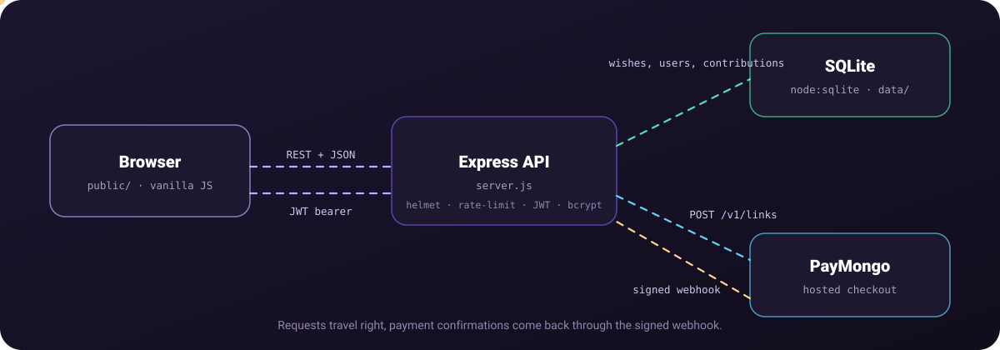
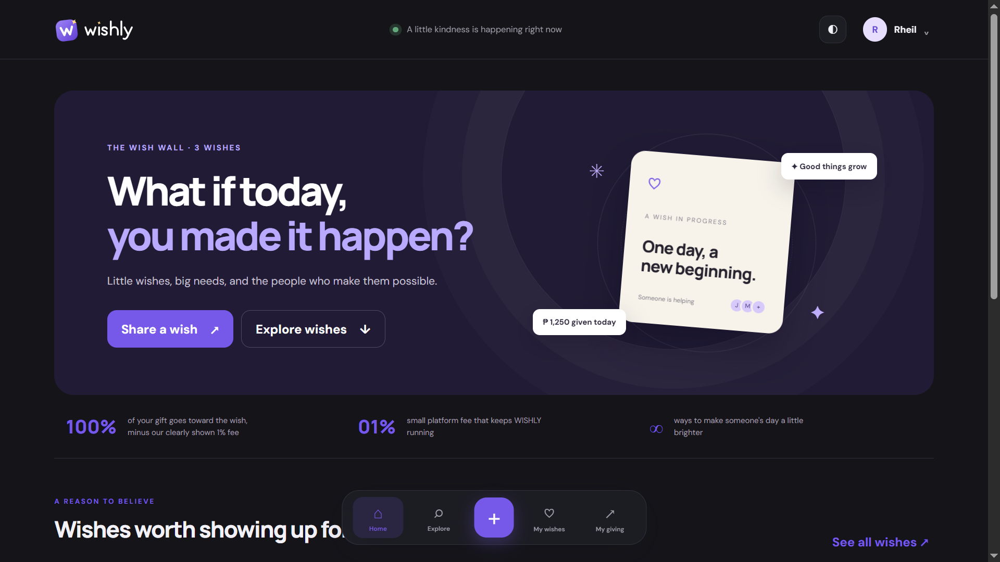
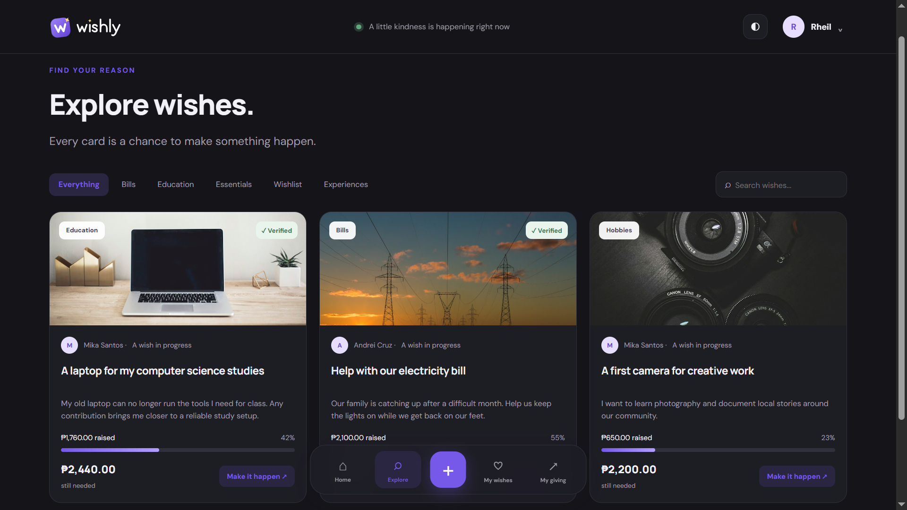

<div align="center">




<br>


<br><br>

<a href="#overview">Overview</a> &nbsp;·&nbsp;
<a href="#screenshots">Screenshots</a> &nbsp;·&nbsp;
<a href="#features">Features</a> &nbsp;·&nbsp;
<a href="#how-a-gift-works">How a gift works</a> &nbsp;·&nbsp;
<a href="#quick-start">Quick start</a> &nbsp;·&nbsp;
<a href="#the-login-experience">Login effects</a> &nbsp;·&nbsp;
<a href="#api-reference">API</a> &nbsp;·&nbsp;
<a href="#project-structure">Structure</a> &nbsp;·&nbsp;
<a href="#honest-scope">Scope</a> &nbsp;·&nbsp;
<a href="#contributing">Contribute</a>

</div>


## Overview

**WISHLY** is a wish-gifting and bill-assistance starter platform. People share a wish, browse what others need, contribute toward a goal, and keep a record of their giving. A floating bottom dock replaces the usual sidebar, and the whole interface works in light and dark.

- **Transparent fee.** WISHLY keeps a clearly shown **1%** of each completed gift. The other **99%** is allocated to the wish. The fee is taken *out of* the contribution, never added on top.
- **Small and readable.** One Express file for the backend, one `node:sqlite` database file, and a front end written in plain HTML, CSS and JavaScript. No build step.
- **Safe by default.** Passwords are hashed with bcrypt, sessions are JWTs, the PayMongo secret key stays on the server, and the payment webhook verifies an HMAC signature and is idempotent.

**Who it is for:** developers who want a working full-stack starting point for a gifting or crowdfunding idea, and teams prototyping the experience before building the regulated parts.

<div align="center">



<sub>The browser never sees the PayMongo key. Confirmations return through a signed webhook.</sub>

</div>

> [!IMPORTANT]
> **This is a starter, not a ready-to-launch marketplace.** It does not escrow money, split payments, or pay out to wishers. Read [Honest scope](#honest-scope) before you accept real payments.


## Screenshots

<div align="center">



<sub><b>Homepage</b>: the Wish Wall with category filters, progress bars and verified labels.</sub>

</div>

<br>

<table>
  <tr>
    <td width="50%" valign="top">
      <br>
      <sub><b>Log in</b><br>A drifting wall of tiles, a targeting crosshair and a spark on every click, next to a form with inline validation.</sub>
    </td>
    <td width="50%" valign="top">
      <br>
      <sub><b>Explore</b><br>Search and filter every wish. Open a card to see the fee breakdown and give.</sub>
    </td>
  </tr>
  <tr>
    <td width="50%" valign="top">
      <br>
      <sub><b>Create a wish</b><br>Title, story, category, target amount and an optional image. Bill wishes add provider, reference and due date.</sub>
    </td>
    <td width="50%" valign="top">
      <br>
      <sub><b>My wishes</b><br>Everything you have published, with live progress.</sub>
    </td>
  </tr>
  <tr>
    <td colspan="2" valign="top">
      <br>
      <sub><b>My giving</b><br>Gifts completed, total contributed, and a history showing each amount and its 1% fee.</sub>
    </td>
  </tr>
</table>


## Features

| Area | What you get |
|---|---|
| **Accounts** | Email and password sign-up and login, bcrypt hashing, 7-day JWT sessions, friendly inline validation. |
| **Wish Wall** | Search, category filters, progress bars and a *Verified* badge for reviewed wishes. |
| **Create wishes** | Wishlist, Bills, Education, Essentials, Experiences and Hobbies. Bill wishes capture provider, reference and due date, stored privately. |
| **Giving** | Partial contributions and a hosted PayMongo payment-link checkout. |
| **Fee transparency** | The 1% fee is previewed before checkout and recorded on every contribution. Configurable with `PLATFORM_FEE_PERCENT`. |
| **Webhook** | `POST /api/payments/webhook` confirms paid contributions using HMAC-SHA256 and ignores duplicates. |
| **Your space** | My wishes, My giving history, a profile page, and an admin overview. |
| **Design** | Responsive layout, light and dark themes, a floating dock, and tasteful motion that respects *reduce motion*. |
| **Storage** | SQLite through Node's built-in `node:sqlite`, seeded with demo content. Nothing native to compile. |


## How a gift works

<div align="center">



</div>

| Step | What happens | Where to read it |
|---|---|---|
| **Choose** | The giver opens a wish and picks an amount (minimum ₱100, no more than what is still needed). | `public/app.js` |
| **Record** | The server stores a `pending` contribution with the amount, the 1% fee and the net amount. | `server.js` |
| **Link** | It creates a PayMongo payment link with the secret key and returns the hosted `checkoutUrl`. | `server.js` |
| **Pay** | The giver is redirected to PayMongo's hosted checkout. WISHLY never touches card details. | PayMongo |
| **Confirm** | PayMongo calls the webhook. The signature is verified, the contribution is marked `paid`, and the wish's collected amount grows by the net amount. | `server.js` |

A gift is only counted **after** the webhook confirms payment, never when the giver is redirected.


## Quick start

**Requirements:** Node.js **26 or newer** (WISHLY uses the built-in `node:sqlite` module) and npm, which ships with Node.

```bash
# 1. Install dependencies
npm install

# 2. Create your environment file
cp .env.example .env        # Windows PowerShell: Copy-Item .env.example .env

# 3. Edit .env and set a long random JWT_SECRET, then start the app
npm run dev
```

Open **http://localhost:4000**. Browsing wishes and creating an account work without any PayMongo keys. Add PayMongo **test** keys to `.env` only when you want to try checkout.

**Demo accounts** (seeded into a fresh database):

| Email | Password |
|---|---|
| `mika@example.com` | `wishly-demo-2026` |
| `andrei@example.com` | `wishly-demo-2026` |

> [!WARNING]
> Change these credentials or remove the seed users before you deploy anywhere public.

**Check your setup**

```bash
npm run check    # syntax-check server.js
npm run smoke    # with the server running: health, wish list, signup and login
```

**Make yourself an admin** (local development):

```sql
UPDATE users SET role = 'admin' WHERE email = 'your-email@example.com';
```

<details>
<summary><b>Configuration</b></summary>

<br>

| Variable | Purpose |
|---|---|
| `PORT` | Port to listen on. Default `4000`. |
| `JWT_SECRET` | Secret used to sign sessions. **Set a long random value.** |
| `CLIENT_URL` | Allowed CORS origin. |
| `DATABASE_FILE` | SQLite file path. Default `./data/wishly.sqlite`. |
| `PLATFORM_FEE_PERCENT` | The platform fee. Default `1`. |
| `PAYMONGO_SECRET_KEY` | PayMongo secret key (use a `sk_test_` key first). Server-side only. |
| `PAYMONGO_PUBLIC_KEY` | Reserved for future client-side features. |
| `PAYMONGO_WEBHOOK_SECRET` | Webhook signing secret from the PayMongo dashboard. |

</details>

<details>
<summary><b>PayMongo setup</b></summary>

<br>

1. Create a PayMongo merchant account and complete their business verification.
2. Start with **test** keys. Put the secret key in `PAYMONGO_SECRET_KEY`.
3. Deploy the backend over HTTPS and add a webhook pointing to `https://YOUR_DOMAIN/api/payments/webhook`.
4. Subscribe to the payment-link or payment-paid event your dashboard offers and copy the signing secret into `PAYMONGO_WEBHOOK_SECRET`.
5. Test successful, failed, duplicate and delayed webhook deliveries before using live keys.

Verify the exact event names and signing procedure in PayMongo's current documentation. Provider behaviour can change.

</details>

<details>
<summary><b>Troubleshooting</b></summary>

<br>

- **`node:sqlite` not found.** You need Node 26 or newer. Check with `node --version`.
- **Install fails on Windows with `EBUSY`.** Close terminals and editors using the folder, delete `node_modules` and `package-lock.json`, then run `npm install` again.
- **"PayMongo is not configured yet."** Add a test secret key to `.env`. Checkout is the only feature that needs it.
- **I can't create an account.** Passwords need at least 8 characters, and the email must look like `you@example.com`. Duplicate emails are reported under the email field.
- **Animations feel too calm.** If your OS has *reduce motion* enabled, WISHLY skips the wall, crosshair and sparks.

</details>


## The login experience

<div align="center">



<sub>Move the pointer over the left panel, click anywhere, and watch the form react.</sub>

</div>

| Piece | What it does |
|---|---|
| **Drift wall** (`public/fx/drift-wall.js`) | A tilted 3D wall of tiles drifting in alternating columns. Hovering lifts a tile and pauses its column. Pointer movement gently tilts the whole wall. |
| **Crosshair** (`public/fx/crosshair.js`) | Lines with coordinate tags follow the pointer, and lock onto a tile with corner brackets and a size readout. Mouse devices only. |
| **Click spark** (`public/fx/click-spark.js`) | A burst of stars and a ring on every click or tap, app-wide. |
| **Form polish** | Inline errors, a shake on failure, show/hide password, a strength meter, a name field that slides open, and a loading spinner. |
| **Logo motion** | The sparkle in the WISHLY mark twinkles. |
| **In-app motion** | Staggered card entrances, progress bars that fill, a pulsing live dot, and a dock that lifts on hover. |
| **Accessibility** | The wall is decorative: hidden from screen readers and not in the tab order. `prefers-reduced-motion` turns the effects down. |

The three effects are dependency-free ports of the **DriftWall**, **Crosshair** and **ClickSpark** components from [React Bits](https://reactbits.dev), rewritten as plain ES modules so the project needs no React and no build step. Check React Bits' license terms before you redistribute them.


## API reference

Base URL: `http://localhost:4000`. Authenticated routes need `Authorization: Bearer <token>`.

| Method | Endpoint | Auth | Purpose |
|---|---|---|---|
| `GET` | `/api/health` | | Health and configuration status. |
| `POST` | `/api/auth/signup` | | Create an account. Returns `201` with `{ token, user }`. |
| `POST` | `/api/auth/login` | | Sign in. Returns `{ token, user }`. |
| `GET` | `/api/wishes` | | Browse wishes. Optional `category` and `search`. |
| `POST` | `/api/wishes` | user | Create a wish. |
| `GET` | `/api/wishes/mine` | user | The current user's wishes. |
| `GET` | `/api/me` | user | Account summary and giving totals. |
| `GET` | `/api/contributions/mine` | user | Contribution history. |
| `POST` | `/api/contributions/checkout` | user | Start a PayMongo checkout for a wish. |
| `POST` | `/api/payments/webhook` | signature | PayMongo payment confirmation. |
| `POST` | `/api/reports` | user | Report a wish. |
| `GET` | `/api/admin/overview` | admin | Totals and recent contributions. |
| `PATCH` | `/api/admin/wishes/:id/verify` | admin | Set or clear the Verified badge. |

**Errors** are JSON: `{ "error": "message" }`. Signup errors also include `field` (`name`, `email` or `password`) so a form can highlight the right input, and use `400` for invalid input, `409` for an email already in use, and `500` for server problems.


## Project structure

```text
WISHLY/
├── lib/
│   └── validation.js        signup validation (no Express or DB imports, easy to test)
├── public/
│   ├── images/              logo.svg, logo-light.svg, logo-mark.svg, favicon.svg, tiles/
│   ├── fx/                  drift-wall, crosshair, click-spark and init.js
│   ├── index.html           markup for the auth screen and the app
│   ├── styles.css           base theme and layout
│   ├── animations.css       motion, logo swapping and auth polish
│   └── app.js               client logic: auth, wishes, giving, navigation
├── scripts/
│   └── smoke.js             health, wishes, signup and login checks
├── data/                    created automatically (SQLite file)
├── server.js                Express API, SQLite schema, PayMongo and webhook
├── .env.example
├── package.json
├── README.md
└── CONTRIBUTING.md
```


## Honest scope

WISHLY is a **functional starter**. Please read this before real money is involved.

- **It does not move money to wishers.** PayMongo collects payments into the merchant account. Nothing is split, escrowed or paid out automatically.
- **Payouts need a real process.** Admin review and an auditable payout workflow are required before funds reach a beneficiary, and bill payments must go to the actual biller through an approved route. The UI describes bill assistance as reviewed and disbursed by the operator, so do not promise instant payment.
- **Get advice first.** Before accepting live money, obtain legal and accounting advice on payment-services, crowdfunding and solicitation, consumer-protection, AML and KYC, privacy, tax, and charitable-fundraising rules that apply to you, and confirm your model with PayMongo.
- **Sensitive data is not encrypted.** Bill references are stored privately but without field-level encryption. Do not use real bill data until encryption and access policies exist.
- **Not production-hardened.** Add HTTPS, secure cookies or refresh-token rotation, CSRF protection where relevant, backups, monitoring, secrets management, identity and beneficiary verification, fraud and abuse operations, refund and chargeback handling, a payout ledger, audit logs and support.
- **No license file ships yet.** Add one before you publish or accept outside contributions.

## Roadmap

Nothing below is built yet. These are ideas, in no particular order:

- [ ] Wish images uploaded and moderated, instead of pasted URLs
- [ ] Email verification and password reset
- [ ] A payout ledger and reconciliation view for admins
- [ ] Beneficiary and bill verification workflow
- [ ] Wish updates and thank-you messages from wishers to givers
- [ ] Automated API tests and browser-level UI tests

## Contributing

Bug reports, docs, tests and polish are welcome. Start with **[CONTRIBUTING.md](CONTRIBUTING.md)**: it covers setup, how to add a wish category, how to work on the animations, and the money-handling rules every change must respect.


<div align="center">


<sub>Built so a small kindness can travel a long way.</sub>

</div>
