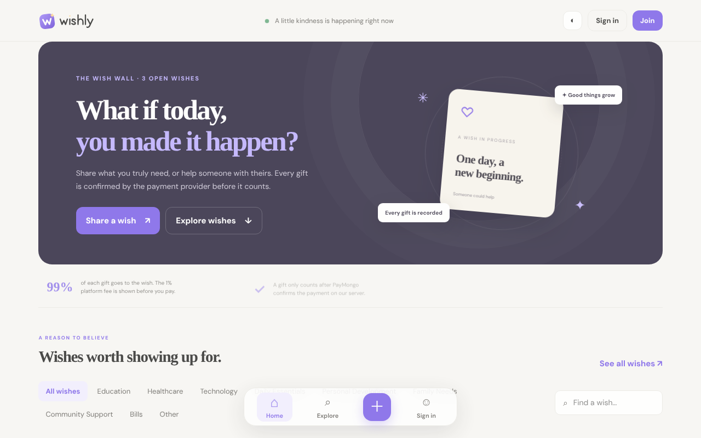
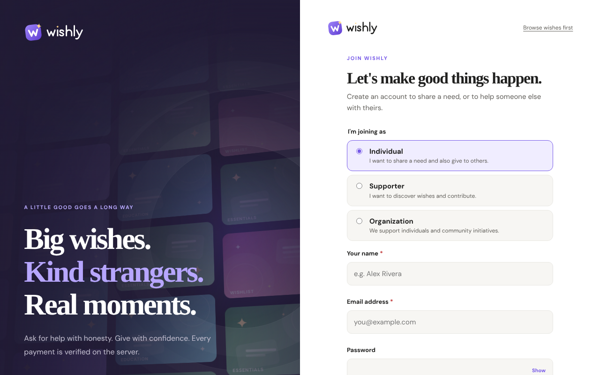
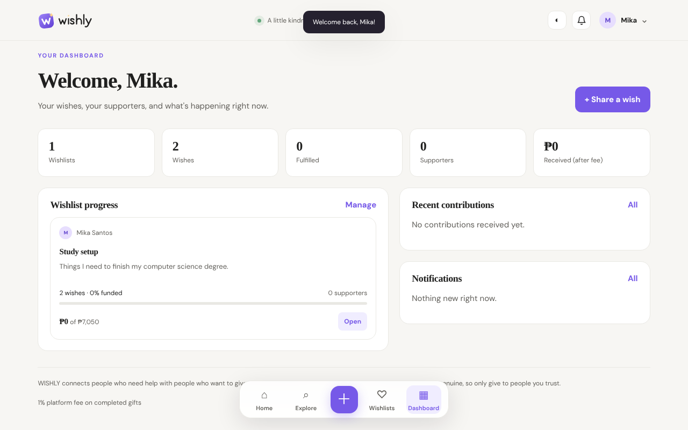
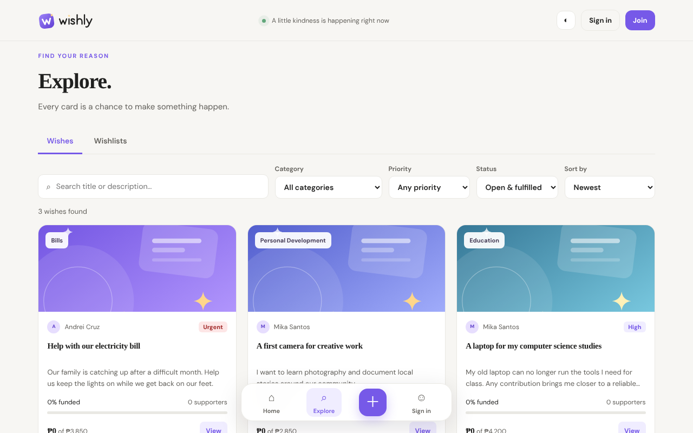

<div align="center">


<br><br>

<a href="#overview">Overview</a> · <a href="#screenshots">Screenshots</a> · <a href="#features">Features</a> · <a href="#quick-start">Quick start</a> · <a href="#configuration">Configuration</a> · <a href="#paymongo-setup">PayMongo</a> · <a href="#deploy-to-vercel--postgresql">Deploy</a> · <a href="#security">Security</a> · <a href="#testing">Testing</a> · <a href="#known-limitations">Limitations</a>

</div>


## Overview

**WISHLY** is a wishlist and community-contribution platform. People publish wishlists of things they genuinely need, supporters discover them and give, and everyone can see honest progress. Administrators review reports and verification requests.

**Principle:** make it easier to ask for help, easier to give, and safer for everyone involved.

- **A gift only counts when the server says it was paid.** A contribution becomes `paid` in exactly one place (`src/services/payments.js → applyPaid`), reached only from a signature-verified PayMongo webhook (which re-checks the link with PayMongo) or a server-to-server status sync. Returning to a "success" page proves nothing.
- **Transparent fee.** WISHLY keeps a clearly shown 1% (`PLATFORM_FEE_PERCENT`), taken out of the contribution, never added on top.
- **No fake numbers.** Progress, dashboards and admin statistics are computed from database records. Nobody is labelled *Verified* without an admin review.
- **No new framework.** Dependency-free Node HTTP handler, plain-JS ES-module front end (no build step), one runtime dependency (`pg`, used only when `DATABASE_URL` is set).

> [!IMPORTANT]
> WISHLY does **not** escrow money, split payments, or pay out to wishers. PayMongo collects into the merchant account. See [Known limitations](#known-limitations) before accepting real payments.


## Screenshots

<table>
  <tr>
    <td width="50%"><br><sub><b>Home</b>: discovery with search, categories and progress.</sub></td>
    <td width="50%"><br><sub><b>Sign up</b>: Individual, Supporter or Organization.</sub></td>
  </tr>
  <tr>
    <td width="50%"><br><sub><b>Dashboard</b>: real totals, progress and notifications.</sub></td>
    <td width="50%"><br><sub><b>Explore</b>: filter, sort and paginate public wishes.</sub></td>
  </tr>
</table>


## Features

| Area | What exists |
|---|---|
| **Accounts** | Register, login/logout, e-mail verification, forgot/reset password, password-strength rules, scrypt hashing, server-side sessions in an HttpOnly cookie (hashed in the database, expire after `SESSION_DAYS`), change password, profile edit, notification preferences, account deletion (personal data anonymised, financial records kept). |
| **Roles** | `individual`, `supporter`, `organization`, `admin`. Every route declares its allowed roles in `src/routes.js`, enforced in `src/app.js` on the server. Admin can only be granted with `npm run make-admin`. |
| **Wishlists & wishes** | Multiple wishlists; visibility `public` / `unlisted` (share link) / `private`; wishes with description, category, priority, target, optional deadline and image URL; edit, delete, mark fulfilled. |
| **Discovery** | Search title/description, category and priority filters, sort by newest / progress / recently updated, pagination, empty/loading states. Private lists never appear in search or public endpoints. |
| **Contributions** | Amount validated on the server, optional message, public/anonymous choice, review step, duplicate-checkout guard, history for supporters, received list for owners. |
| **Payments** | PayMongo Links, payment reference, `transactions` ledger, HMAC-SHA256 webhook verification, duplicate-event de-duplication, idempotent processing, amount-mismatch flagging, failed/cancelled/refunded states, daily expiry cron. |
| **Trust & safety** | Report wishlist/wish/user, admin review queue, account suspension/ban, verification requests with an actual review, audit log, database-backed rate limits, content screening for card numbers/OTP requests. |
| **Notifications** | New contribution, payment success/failed, progress milestones (25/50/75% only), fulfilment, supporter messages, verification updates, announcements. Read/unread, mark all, delete, preferences. |
| **Dashboards** | Individual, Supporter, Organization and Administrator (users, wishlists, contributions, pending verifications, reports, suspicious indicators, recent transactions, audit logs). |
| **UI** | Light/dark theme, responsive layout down to phones, skip link, labelled forms, focus rings, live regions, reduced-motion support; React Bits login effects (DriftWall, Crosshair, ClickSpark). |


## Quick start

**Requirements:** Node.js **22.13 or newer** (uses built-in `node:sqlite` for local development) and npm.

```bash
cd WISHLY
npm install                 # installs pg (only used with DATABASE_URL)
cp .env.example .env        # local defaults work without edits
npm run migrate             # creates ./data/wishly-v2.sqlite (also runs automatically on start for SQLite)
npm run seed                # optional demo data: mika@ / andrei@ / sam@example.com, password wishly-demo-2026
npm run dev                 # http://localhost:4000  (use `npm start` for a plain run)
```

With no `RESEND_API_KEY`, verification and reset links are printed to the server console. Without PayMongo keys, browsing and sign-up work and checkout is disabled with a clear message.

```bash
npm test                              # 63 tests, in-memory SQLite, no network
npm run build                         # syntax check of server+client, secret scan of /public, migration check
npm run smoke                         # with the server running: signup/cookie/login/logout against real HTTP
npm run make-admin -- you@example.com # promote an account you own to administrator
```

**Upgrading from the original starter:** the old database (`data/wishly.sqlite`) is never modified. Import it with `npm run import:legacy -- ./data/wishly.sqlite`. Passwords keep working (upgraded on next login), e-mails are marked *unverified*, and the old per-wish "verified" badges are intentionally dropped because verification now needs an admin review.


## Configuration

All settings are environment variables (see [`WISHLY/.env.example`](WISHLY/.env.example)). Never commit `.env`.

| Variable | Purpose |
|---|---|
| `APP_URL` | Public base URL (e-mail links, CSRF origin check). **Must be `https://` in production.** |
| `DATABASE_URL` | PostgreSQL connection string. Empty → local SQLite. Use the **pooled** string on Vercel. |
| `PG_POOL_MAX` | Connections per serverless instance (default 3). |
| `AUTO_MIGRATE` | Defaults to on for SQLite and **off** for PostgreSQL (run `npm run migrate`). |
| `PAYMONGO_SECRET_KEY` | Server-side only. Start with `sk_test_…`. |
| `PAYMONGO_WEBHOOK_SECRET` | Signing secret of your PayMongo webhook. **Required in production once the secret key is set.** |
| `PLATFORM_FEE_PERCENT` | Default `1`. |
| `PENDING_EXPIRY_HOURS` | Unpaid checkouts older than this are cancelled by the cron. |
| `RESEND_API_KEY`, `EMAIL_FROM` | Transactional e-mail via Resend. `EMAIL_FROM` must use a domain you verified. |
| `REQUIRE_EMAIL_VERIFICATION` | Keep `true` in production. |
| `CRON_SECRET` | Random string protecting `/api/cron/expire`. |
| `SESSION_DAYS`, `TRUST_PROXY` | Session length; real client IP behind a proxy (default on in production). |


## PayMongo setup

1. Create a PayMongo account and copy the **test** secret key into `PAYMONGO_SECRET_KEY`.
2. In *Developers → Webhooks*, create a webhook for the event **`link.payment.paid`** pointing at `https://<your-domain>/api/payments/webhook`. Copy its signing secret into `PAYMONGO_WEBHOOK_SECRET`.
3. For local testing, expose your machine with a tunnel (for example `ngrok http 4000`) and use that URL for the webhook.
4. Give with a PayMongo test payment method. The contribution turns `paid` only after the webhook (or the *Check payment status* sync) is verified against PayMongo.
5. **Going live** is a separate step: swap in `sk_live_…` and the live webhook secret, and complete PayMongo's activation and your legal review first.


## Deploy to Vercel + PostgreSQL

SQLite files do **not** persist on Vercel, so production needs PostgreSQL (Neon or Supabase).

1. **Database.** Create a Neon or Supabase project and copy the **pooled** connection string (Neon: *Pooled connection*; Supabase: transaction pooler, port 6543).
2. **Migrate** from your machine once, and again after each release that adds migrations:
   ```bash
   DATABASE_URL="postgres://…pooled…" npm run migrate
   ```
3. **Vercel project.** Import the repository and set the **Root Directory to `WISHLY`**. `vercel.json` already sets the build command, output directory (`public`), the `/api/*` rewrite to `api/index.js`, security headers and a daily cron (`/api/cron/expire`).
4. **Environment variables** (Project Settings): `NODE_ENV=production`, `APP_URL`, `DATABASE_URL`, `PAYMONGO_SECRET_KEY`, `PAYMONGO_WEBHOOK_SECRET`, `RESEND_API_KEY`, `EMAIL_FROM`, `CRON_SECRET`. The app refuses to start in production without `DATABASE_URL`, an `https` `APP_URL`, and the webhook secret when payments are enabled.
5. **Webhook.** Point PayMongo at `https://<your-domain>/api/payments/webhook`.
6. **First admin.** Sign up normally, then run `DATABASE_URL=… npm run make-admin -- you@example.com`.
7. **Check.** Open `/api/health` (reports database, payments and e-mail configuration).

Notes: Vercel Hobby limits cron jobs to once a day, which is what `vercel.json` uses. Images are pasted `https` URLs, so no file storage is needed. Adding uploads later requires Supabase Storage or similar.


## Security

- **Authentication:** scrypt password hashing, constant-time login (no account enumeration), opaque session tokens stored only as SHA-256 hashes, HttpOnly + SameSite=Lax (+ Secure in production) cookies, sessions revoked on password reset/change and account deletion.
- **Authorization:** declared per route and enforced server-side; owners can only modify their own records; private content is excluded at query level.
- **Payments:** secret key never reaches the browser; amounts and fees are computed on the server; webhook signature verified (HMAC-SHA256, constant-time) and re-checked with PayMongo; events de-duplicated; paying twice is a no-op; amount mismatches are flagged, not applied.
- **Web:** parameterized SQL only; every dynamic value in the UI is HTML-escaped by the `h` template tag; strict CSP (`script-src 'self'`), `X-Frame-Options: DENY`, `nosniff`, HSTS in production; Origin check on browser writes; request-size limits.
- **Abuse:** database-backed rate limits (global write budget, login, signup, reset, checkout, reports), duplicate-checkout and duplicate-report prevention, audit log of sensitive actions.
- **Secrets:** `.env` and database files are git-ignored; `npm run build` fails if secret-looking values appear in `/public`.

Found a vulnerability? Please report it privately to the maintainer rather than opening a public issue.


## Project structure

```text
WISHLY/
├── server.js            local entry point (plain Node http)
├── api/index.js         Vercel serverless entry (same app)
├── vercel.json          rewrites, headers, daily cron
├── src/
│   ├── app.js           dispatcher: CSRF, rate limits, sessions, role checks
│   ├── routes.js        the whole API and its access rules
│   ├── config.js        environment configuration + production assertions
│   ├── db/              SQLite/PostgreSQL adapter and migrations
│   ├── services/        auth, wishlists, contributions, payments, moderation, admin, notifications, dashboard
│   └── lib/             crypto, validation, PayMongo client, mailer, audit, rate limiting
├── public/              front end (index.html, js/ ES modules, css, fx/ effects, images/)
├── scripts/             migrate, seed, make-admin, import-legacy, build-check, smoke
└── tests/               node:test suites (auth, wishlists, payments, admin, hardening)
```


## Testing

```bash
cd WISHLY && npm test && npm run build
```

63 automated tests cover registration, login, sessions, password reset, role restrictions, wishlist visibility and progress calculation, checkout validation, webhook signature verification, duplicate and replayed webhooks, amount mismatches, failed payments, refunds, moderation, verification workflow, audit logs and rate limiting. They run against in-memory SQLite with a fake PayMongo and mailer, so **no real PayMongo call and no PostgreSQL instance has been exercised by the test suite**.


## Known limitations

- **No payouts or escrow.** Money lands in your PayMongo merchant account. A payout/disbursement process (and the legal, KYC and accounting groundwork for it) is not built. Do not promise instant payment to wishers.
- **PostgreSQL is unverified end to end.** The SQL is written to be portable and the adapter is in place, but the suite runs on SQLite. Run `npm run migrate` and a full manual pass on a Neon/Supabase *staging* database before launch.
- **PayMongo live mode** has not been exercised. Test with sandbox keys first.
- **Organizations** can register, keep a profile and give, but organization verification is the generic admin review; there is no separate initiatives module yet.
- **Images are URLs**, not uploads. They are not moderated automatically.
- **No MFA, no CAPTCHA, no CDN-level rate limiting.** Rate limits are per client IP and per account in the database.
- **Bill reference numbers** are stored without field-level encryption.
- **Refunds** are recorded by an admin after refunding in PayMongo; WISHLY does not call the refund API.
- WISHLY cannot guarantee that any request is genuine. Reports, reviews and *Verified* labels reduce risk; they do not remove it. Get legal, tax and compliance advice before accepting live money.

## Contributing

See **[CONTRIBUTING.md](CONTRIBUTING.md)**. Money, privacy and verification rules are non-negotiable.


<div align="center">


</div>
